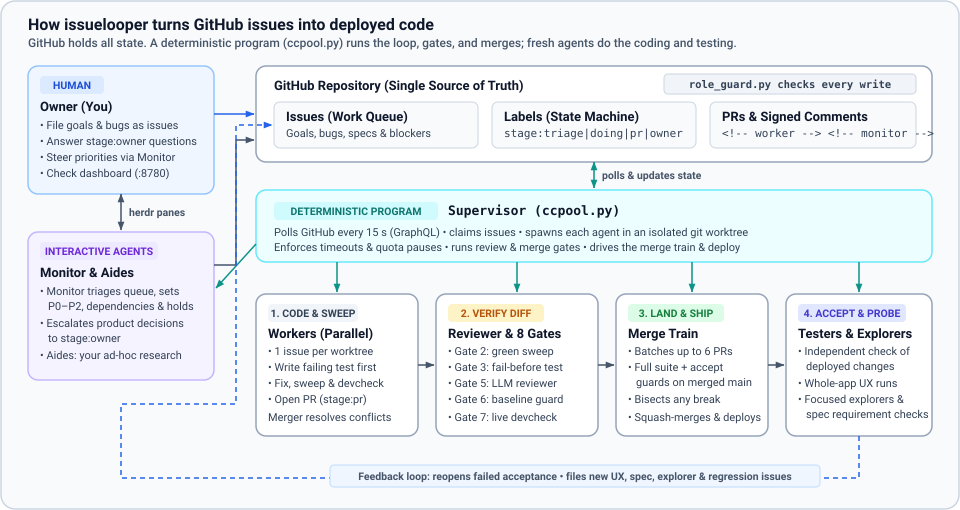
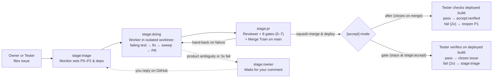
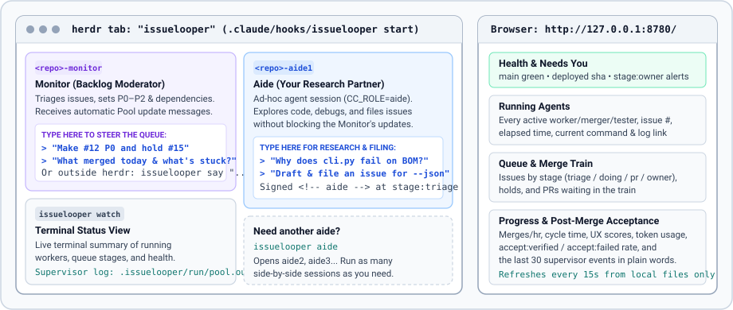

# issuelooper

`issuelooper` runs a team of AI coding agents (`claude` or `agy`) against a GitHub
repository so you can work at the level of issues and product decisions instead of
nursing one prompt at a time. You file goals and bugs as GitHub issues, answer the
questions only a human owner can answer, and let a deterministic supervisor program run
the workers, test gates, merges, deployments, and post-merge checks.

## From one chat to a loop

If you have used Claude Code, Cursor, or Antigravity in a single terminal, you already
know how one agent works. `issuelooper` changes the workflow around the agent:

| Dimension | One interactive agent session | `issuelooper` |
|---|---|---|
| **Unit of work** | A chat prompt you watch turn by turn | A GitHub issue with acceptance criteria and a priority (`P0`–`P2`) |
| **Parallelism** | One task at a time in your checkout | Up to `max_sessions` agents in parallel, each in an isolated `git worktree` |
| **Coordination** | You copy context between chats | GitHub is the state machine: issues are the queue, labels are the stage, PRs are the output, signed comments (`<!-- worker -->`) are the log |
| **Who merges code** | You review the diff and run tests by hand | A deterministic Python program (`ccpool.py`) enforces 8 merge gates, an LLM diff reviewer, and a batch merge train before anything lands on `main` |
| **Permissions** | The agent can run any `git` or `gh` command | A shell hook (`role_guard.py`) restricts each role's GitHub writes and protects the shared checkout and `main` |
| **After merge** | You test the app yourself | Optional deploys, independent acceptance testers, whole-app UX journeys, and focused explorers file regressions or new issues back into the queue |



## The lifecycle of one issue

Every issue moves through explicit GitHub labels. You can inspect or override the queue
at any time from the GitHub UI or the `gh` CLI.



Before any pull request merges, the supervisor verifies 8 gates: clean shared checkout
(**Gate 0**), valid Python syntax with no conflict markers (**Gate 1**), a green sweep
record for the PR's head SHA (**Gate 2**), a test that failed before the fix and passes
after it (**Gate 3**), the closing keyword required by `[accept] mode` (**Gate 4**),
approval from the tool-free LLM diff reviewer (**Gate 5**), intact protected paths and
baseline tests (**Gate 6**), and an optional pre-PR live run via `devcheck.py`
(**Gate 7**). See [How It Works](docs/how-it-works.md) for the full gate and merge-train
rules.

## The roles

One role is a deterministic program; the others are agent sessions launched with
`CC_ROLE=<role>` via `ccrole.sh` and policed by `role_guard.py`.

| Role | Kind | What it does |
|---|---|---|
| **Supervisor** | Program (`ccpool.py`) | Polls GitHub every 15 s via GraphQL, claims issues, spawns agents in worktrees, enforces gates, runs the merge train, and deploys `main`. |
| **Monitor** | 1 long-lived agent | Triages incoming issues, sets priorities (`P0`–`P2`) and dependencies, manages holds, and flags product questions for you at `stage:owner`. |
| **Aide** | Interactive agent(s) | Your on-demand partner in a terminal pane for code research, debugging, and drafting or filing new issues (`<!-- aide -->`). |
| **Worker** | 1 agent per issue | Reproduces the issue with a failing pytest test, implements the fix, runs the test sweep (and optional live `devcheck`), and opens a PR. |
| **Reviewer** | 1 model call, no tools | Reads the PR diff (`review_gate.py`) and rejects fabricated data shown as real, test-gaming logic, and violations of `.issuelooper/review_rules.md`. |
| **Merger** | 1 agent per conflict | Rebases a conflicting PR onto `main` so both changes survive, re-runs the sweep, and hands the clean branch back to the supervisor. |
| **Tester / Explorer** | Agent session(s) | Runs post-merge acceptance checks on the deployed build, walks user journeys (`[ux]`), checks spec requirements (`[spec]`), and probes focused areas (`[explore]`). |

## Try it in 20 minutes

### Requirements

- **GitHub CLI (`gh`)** installed and signed in (`gh auth status`).
- **Python 3.11+** and **[uv](https://docs.astral.sh/uv/)** (used by the samples).
- **An agent CLI** on `PATH` and signed in: Antigravity (`agy`) or Claude Code (`claude`).
- **[herdr](https://herdr.dev)** for the interactive terminal workspace (or set
  `[monitor] host = "broker"` in `.issuelooper/config.toml` to run headless).
- **Linux or macOS** with a single command that runs your test suite (for example
  `make verify`, using pytest for per-issue tests). See
  [macOS validation](docs/macos-verification.md) for platform notes.

### Run the `hello-world` sample

`examples/create.sh` creates a private GitHub repository under your account, installs
`issuelooper`, pushes a small Python CLI (`textstats`) with a deliberate bug, and files
6 seed issues:

```bash
git clone https://github.com/kazunori279/issuelooper
issuelooper/examples/create.sh hello-world <your-github-user>/textstats-demo
```

Start the workspace and the loop:

```bash
cd textstats-demo
herdr --session textstats-demo
# Inside the herdr pane that opens:
.claude/hooks/issuelooper start
```

Over the next 15–30 minutes, four workers claim the issues in priority order, write
failing tests, open PRs, pass the LLM reviewer and merge gates, resolve conflicts on
`cli.py`, and close the queue. Follow the step-by-step guide in
[`examples/hello-world/`](examples/hello-world/), or try the larger 54-issue voice-and-text
sample in [`examples/live-ai-concierge/`](examples/live-ai-concierge/).

## Use it on your own repository

Install the hooks, skills, and starter configuration into an existing Git checkout:

```bash
./issuelooper/install.sh path/to/your-repo
cd path/to/your-repo
$EDITOR .issuelooper/config.toml .issuelooper/project.md .issuelooper/review_rules.md
ISSUELOOPER_CONFIG_OK=1 git commit -am "Configure issuelooper" && git push
gh issue create --title "..." --body "..."
herdr --session your-repo
# Inside the herdr pane:
.claude/hooks/issuelooper start
```

Everything project-specific lives in four files under `.issuelooper/`:

- **`config.toml`**: agent CLI and model per role, sweep and deploy commands, merge
  train, acceptance mode (`"gate"`, `"after"`, or `"off"`), and pool concurrency.
  Validate anytime with `python3 .claude/hooks/config.py check`.
- **`project.md`**: concise commands and paths agents cannot guess (worktree setup, how
  to run one test file, how to start the app on a port, where credentials live).
- **`review_rules.md`**: project-specific rules enforced by the diff reviewer on top of
  its built-in anti-fabrication and anti-test-gaming checks.
- **`monitor_kickoff.md`** *(optional)*: the first instructions sent to the monitor when
  `issuelooper start` launches.

If your repository already uses git hooks (such as Husky or `.git/hooks`), pass
`--chain-hooks` or `--keep-hooks` to `install.sh`. See
[Configuration & CLI Reference](docs/configuration.md) for all installer flags and settings.

## Your day-to-day as the owner

`issuelooper start` opens a `herdr` tab named `issuelooper` alongside a local web
dashboard at `http://127.0.0.1:8780/` (run `issuelooper dashboard` to print the URL, or
`ssh -L 8780:127.0.0.1:8780` when working on a remote machine).



While the loop runs, you interact with it in four ways:

1. **File issues on GitHub.** Any issue you open enters the queue for the monitor to
   triage:

   | You want | Do this |
   |---|---|
   | Something built | File an issue. Add `owner-request` to keep it at least `P1`; the monitor will not lower the priority you give it. |
   | It done first | Label it `P0` (broken now, or required for the minimum viable product). |
   | Work paused | Label it `on hold`. Only you remove `on hold`. |
   | A redo | Reopen the issue and comment what is still wrong. The next worker reads the newest comments first. |

2. **Steer the queue in the Monitor pane.** Type directly into the monitor pane (or run
   `.claude/hooks/issuelooper say "Make #12 P0 and hold #15"` from another terminal).
   The supervisor sends `Pool update:` messages to the monitor when the queue changes
   and waits while you are typing. Keep deep code research out of the monitor so it
   stays free for queue updates.
3. **Research and draft issues in an Aide pane.** Aides (`CC_ROLE=aide`) explore code,
   debug, and file new issues (`stage:triage`, signed `<!-- aide -->`), without touching
   stage labels or merges. Run `.claude/hooks/issuelooper aide` to open more aides.
4. **Answer `stage:owner` questions.** When a worker hits a product ambiguity, fails 3
   times, fails acceptance twice, or lacks a live dependency, the monitor parks the
   issue at `stage:owner` with a concrete question. Check waiting items with
   `gh issue list --label stage:owner` (or the dashboard's **Needs you** section) and
   reply with a normal GitHub comment; your comment resets attempts and wakes the monitor.

### Checking status and stopping

| To see or do | Command / location |
|---|---|
| Live health, running agents, queue, UX scores, events | `http://127.0.0.1:8780/`, `issuelooper watch`, or `issuelooper status` |
| What the supervisor would start next | `.claude/hooks/issuelooper plan` |
| One session's prompt and transcript | `.issuelooper/run/pool/<seq>-<role>-<unit>/` (`prompt.txt`, `session.log`) |
| Pause the loop (keeps aides open, saves WIP branches) | `.claude/hooks/issuelooper stop` |
| Stop everything and prune 2-day-stale scratch dirs | `.claude/hooks/issuelooper stop --all` |

## Where to go next

- **[How It Works (`docs/how-it-works.md`)](docs/how-it-works.md)**: deep dive into the
  deterministic supervisor, `role_guard.py`, the 8 merge gates, the merge train and
  bisection, `"after"` vs `"gate"` acceptance, area conversations, hot-file locks, and
  unattended recovery.
- **[Configuration & CLI Reference (`docs/configuration.md`)](docs/configuration.md)**:
  how to author `.issuelooper/` files, every `config.toml` section and environment
  variable, all `issuelooper` CLI subcommands, headless (`broker`) mode, and repo layout.
- **[Samples (`examples/`)](examples/)**: the 20-minute [`hello-world`](examples/hello-world/)
  walkthrough and the 6-hour [`live-ai-concierge`](examples/live-ai-concierge/) sample.
- **[macOS & Claude Code Validation (`docs/macos-verification.md`)](docs/macos-verification.md)**:
  validation results and platform notes for macOS and `claude`.

## Safety and limits

- **Run on a dedicated machine or VM.** Agent sessions run with CLI permission prompts
  disabled (`--dangerously-skip-permissions`) and rely on `role_guard.py` for workflow
  rules. `role_guard.py` prevents accidental mistakes by well-meaning agents, not
  adversarial escapes, since all sessions share one OS account and GitHub login.
- **Keep repositories private or restrict interactions while running.** Anyone who can
  open issues or comment on a public repository can put text into agent prompts.
  Although the loop ignores state markers (`<!-- claim ... -->`) from untrusted accounts,
  untrusted issue text still reaches worker prompts; enable GitHub interaction limits if
  running on a public repo.
- **One loop per repository; multiple repositories can share a machine.** Each
  repository isolates its worktrees and records under
  `/tmp/issuelooper-<repo>-<hash>/` (`$ISSUELOOPER_TMP`) and selects distinct tester
  ports, while sharing machine-wide `[sweep] slots`.

## License

Apache License 2.0. See [LICENSE](LICENSE).
