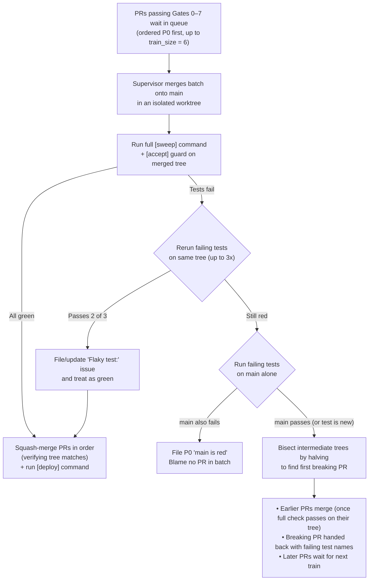
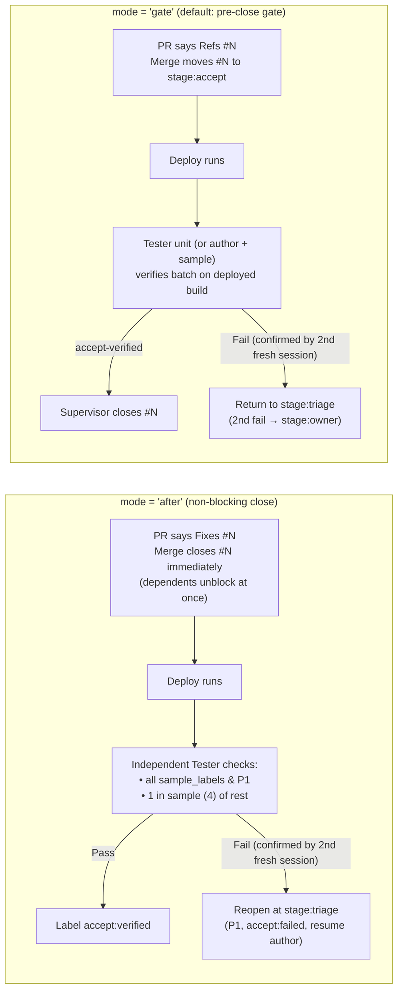

# How issuelooper Works

This guide explains the architecture and safeguards behind `issuelooper`: why a deterministic program drives the loop instead of an agent, what the 8 merge gates verify, how the merge train and post-merge acceptance catch regressions, and how the supervisor recovers from failures during multi-hour unattended runs.

For a quick introduction and 20-minute walkthrough, start with the [README](../README.md). For every `config.toml` key and CLI subcommand, see [Configuration & CLI Reference](configuration.md).

---

## 1. Why a deterministic supervisor and a shell guard

When several AI coding agents work on one repository at the same time, letting agents coordinate directly or merge their own pull requests fails in predictable ways: agents forget to run the full test suite after a rebase, accidentally overwrite shared files, close issues before live verification, or talk past each other.

`issuelooper` separates **judgment and coding** (done by agents) from **state transitions, permissions, and merges** (done by deterministic Python programs):

1. **GitHub is the single source of truth.** Issues are the work queue, labels (`stage:triage`, `stage:doing`, `stage:pr`, `stage:accept`, `stage:owner`, `P0`–`P2`) are the state machine, pull requests are the code output, and HTML-signed comments (`<!-- worker -->`, `<!-- monitor -->`, `<!-- tester -->`, `<!-- aide -->`) record every action.
2. **The supervisor (`ccpool.py`) is a deterministic program.** Every 15 seconds (`POOL_POLL_S`), it reads every page of open issues and pull requests via GitHub's GraphQL API, claims eligible work (`claim.py`), spawns each agent session in its own isolated `git worktree` under `$ISSUELOOPER_TMP`, runs the review and merge gates, drives the merge train, and deploys `main`.
3. **Every agent shell command passes through `role_guard.py`.** Each agent session receives its role from `CC_ROLE` (set by `ccrole.sh`). A `PreToolUse` shell hook (`role_guard.py`) inspects every command before it executes:
   - **GitHub write permissions:** enforces which labels each role may add or remove, blocks agents from merging PRs or closing product issues when forbidden by the workflow, and requires every GitHub comment, issue, or PR body to carry the role's marker (`<!-- <role> -->`).
   - **Shared checkout protection:** refuses `git stash` (because one stash stack is shared across all worktrees) and refuses git commands, `rm`, `mv`, `cp`, `ln`, or shell redirections that would alter the shared checkout from which the supervisor merges and deploys (which holds owner-only files such as `.env`). Any relative path after an unchecked `cd` (anything other than `cd X && ...` or `cd X || exit 1`) is treated as targeting the shared checkout and refused.
   - **Branch and PR protection:** refuses pushes that would empty an issue branch (which causes GitHub to auto-close the PR): a push after `git rebase`, `merge`, or `pull` in the same command unless joined by `&&`, a push from a worktree mid-rebase, or a branch head with zero commits beyond `origin/main` (`.githooks/pre-push` enforces the last two at push time as well).
   - **Background process hygiene:** when `[guard] background_check = true` (the default), refuses background commands (`cmd &`, `nohup`, `setsid -f`) that do not redirect stdout, stderr, and stdin (`> log 2>&1 < /dev/null`), preventing leaked file descriptors from hanging the agent CLI when a turn finishes.
   - **Secret URL filtering:** refuses unfiltered fetches of any URL path listed in `[guard] secret_urls`.

---

## 2. The 8 merge gates (Gates 0–7)

No agent can merge a pull request. The supervisor merges a pull request only when all 8 gates pass. Any gate that cannot be verified (for example, if the guard errors, returns no answer, or cannot read the PR or a changed file from GitHub) is treated as refused, and the supervisor retries on a later poll.

| Gate | Name | What it requires |
|---|---|---|
| **0** | Clean checkout | The shared checkout used by the supervisor for merging and deploying has no uncommitted changes. |
| **1** | Syntax & conflicts | Every changed `.py` file parses cleanly with Python's AST parser and contains no merge conflict markers. |
| **2** | Verified sweep | The PR body names the exact commit SHA it swept, and a matching green sweep record exists in `$ISSUELOOPER_TMP/sweep/`. |
| **3** | Failing test first | The PR records a test file that failed before the fix and passes after it (`Fail-before: <file> N -> M`), or carries an explicit waiver reason. |
| **4** | Closing keyword | The PR's closing keyword matches `[accept] mode`: in `"gate"` mode, product changes (and `needs:live` issues when live checks are on) must use `Refs #N` so merging does not close the issue (`gh pr create` enforces this too); in `"after"` or `"off"` mode, product changes use `Fixes #N`. |
| **5** | Diff reviewer | The LLM reviewer (`review_gate.py`) passed this exact head SHA, or the repository owner posted `review-override: <sha> <why>` on the PR. |
| **6** | Protected paths & baseline tests | Nothing under `[guard] protected_paths` (such as `["spec/"]`) is modified, and no baseline test function disappears. |
| **7** | Pre-PR live check | When `[devcheck]` is enabled, any PR touching `[devcheck] paths` or carrying a `[devcheck] labels` label has a passing `devcheck.py` record covering every triggered acceptance-checklist row (or a stated waiver). |

### Gate 3: The failing-test rule

Before editing application code, a worker must write or update a pytest test in `tests/<suite>/test_issue_<N>.py` that reproduces the issue and fails against the unfixed code. The sweep records the failure count before the fix and the passing count after (`Fail-before: <file> N -> M`). This prevents workers from shipping no-op fixes or tests that pass regardless of the implementation.

### Gate 5: The LLM diff reviewer (`review_gate.py`)

When a PR modifies files under `[review] production_paths` (such as `["src/"]`), `review_gate.py` makes a single tool-free model call to inspect the diff:

- **Two built-in checks:** it rejects (1) fabricated or hard-coded data presented to users as real output (checking literals against `[review] fixtures` when configured), and (2) production code that detects or special-cases test runs or evaluators (identifiers named in `[review] spec_paths` are passed to the reviewer as legitimate product hooks).
- **Project rules:** it enforces every rule in `.issuelooper/review_rules.md` (reporting violations as `project_rule`). A fenced ```` ```prescan ```` block in `review_rules.md` can list regular expressions that flag added lines as hints for the reviewer.
- **File splits:** when reviewing an automatic file-split issue, the gate summarizes blocks moved verbatim so the diff fits cleanly in context.
- **Escalation:** if a PR is rejected more than `[review] max_rejects` (default 2) times, or if the review call itself errors `REVIEW_MAX_ERRORS` (3) times in a row, the supervisor moves the issue to `stage:owner` and never merges it automatically. The owner can inspect the PR and post `review-override: <sha> <why>` to approve that head.

### Gate 6: Protected paths and baseline-test protection

- **Protected paths (`[guard] protected_paths`):** keeps workers from editing owner-controlled files such as `["spec/"]` or smoke scripts to make their task easier.
- **Baseline tests (`[guard] baseline_tests`):** protects the test functions that existed at the commit where `issuelooper` was installed (or the paths/globs configured in `baseline_tests`). Moving a test function to another file is allowed if it keeps its function name; deleting or folding away a baseline test is refused unless the issue carries the `owner-request` label.

### Gate 7: Pre-PR live check (`devcheck.py`) and the shared acceptance checklist

Test suites usually run against test doubles (a scripted model or fake backend), so a branch can pass `make verify` and still fail when started against real services. With `[devcheck] enabled = true`:

1. After committing, the worker runs `.claude/hooks/devcheck.py`.
2. `devcheck.py` acquires one of `[devcheck] slots` (default 2), starts the application from the worktree in the real environment on its own port (`[devcheck] port_base + slot`), waits for `[devcheck] ready_path` to answer with HTTP status `< 500`, runs the project smoke command (`[devcheck] command`), and then runs the worker's issue-replay script.
3. Because real-environment checks take longer, enabling `[devcheck]` raises the default worker timeout from 45 minutes to 60 minutes.
4. **Rebase reuse and replay:** if a later rebase only moves the branch onto a newer `main` without changing what the branch does (its change key is unchanged), the existing `devcheck` record stays valid. If conflict resolution alters the branch's change key, the supervisor automatically replays the recorded check on the new head (`devcheck.py --rerun`) and hands the PR back only if the replay fails.

**The shared acceptance checklist (`[accept]`):**
In user-facing apps, reopened issues most often trace back to partial implementations in recurring edge cases: narrow mobile viewports (`320x640`), keyboard navigation (`Escape`), secondary languages, live voice barge-in, or differences between live and scripted modes. You can list these once in `config.toml` under `[accept]` (`viewports`, `languages`, `always`, `live`, `no_skip`, and path-glob `[accept.triggers]`).

Both the worker and the post-merge tester receive this checklist in their prompts:
- The worker's `devcheck` script declares the rows it exercised (`# accept-rows: viewport:320x640 lang:ja`) or explains why a row cannot apply (`# accept-skip: <id> <why>`).
- Gate 7 refuses any PR whose `devcheck` record misses a row triggered by the PR's changed paths, or skips a row listed in `[accept] no_skip`.

---

## 3. Sweeps and the merge train

### Fast affected sweeps on PR branches

When the merge train is enabled (the default), individual PR sweeps (run by a worker, a merger, or a supervisor re-sweep) do not need to run the entire test suite every time if you configure `[sweep] affected = "<command with {tests}>"`:

- `sweep_run.py` selects changed test files, tests that import a changed Python module, tests mapped via `[sweep] affected_map`, and (for any JS, HTML, or CSS change) all browser tests, since browser tests reach UI files through rendered pages rather than Python imports.
- If a UI change selects more than `[sweep] affected_browser_cap` (default 10) browser test files, or if a change touches an unmapped file or a path in `[sweep] affected_full` (such as `conftest.py`, `pyproject.toml`, lockfiles, `Makefile`, or fixtures), `sweep_run.py` runs the full `[sweep] command` instead.
- Acceptance regression tests (`tests/accept/`, configured in `[sweep] affected_exclude`) are skipped during per-PR sweeps because the merge train runs them on the combined tree.
- If `[sweep] format` is set, worker and merger sweeps run the formatter first on a clean worktree and stop if files change so the agent can commit the formatting and re-sweep.

### How the merge train lands PRs

Even when two PRs have no git conflict, their combination can still break `main` (for example, one PR renames a helper that another PR newly calls). By default (`[pool] merge_train = true`), PRs that pass Gates 0–7 wait in a queue and land in batches:



Key details of the merge train:
- **Batching (`[pool] train_size`, `train_wait_s`):** takes up to `train_size` (6) queued PRs, ordered by priority (`P0` first). If `train_wait_s` is set above 0, the supervisor waits up to that many seconds after the first PR enters the queue for others to join, unless the queue is already full or contains a `P0` PR.
- **Guard isolation:** if acceptance guards (`[accept] guard`) fail when run together on the train tree but pass when run one at a time, the failure is treated as a test-isolation issue rather than blamed on the PR.
- **Author guard recovery (`[pool] author_guard`):** when enabled, if a train's acceptance guard fails solely because of one PR, the supervisor resumes that PR's author conversation (up to `POOL_AUTHOR_GUARD_MAX` = 2 tries) to either fix the regression or document an intentional change with a `Guard change:` line in the PR body (verified by the review gate).

### When the merge train is off (`[pool] merge_train = false`)

If you disable the merge train (or have no `[sweep] command`), each PR merges individually:
- **Pre-merge quick check (`[sweep] fast_command`):** when a PR's head is behind `main`, the supervisor merges it with current `main` in a worktree right before merging and runs `fast_command` (for up to `POOL_FAST_CHECK_S` = 120 s). A failure hands the PR back unless `main` alone also fails `fast_command`. A timeout holds the PR, and a second timeout on the same head hands it back.

### Background `main_check`, flaky tests, and the `main is red` hold

Whenever `main` advances to a commit that was not already checked as a whole by the merge train, and `[sweep] main_check = true` (the default), the supervisor runs the full `[sweep] command` on `main` in a dedicated background lane (up to `POOL_MAIN_CHECK_S` = 1200 s):

- **Machine errors vs test failures:** if a check fails due to a host resource error (such as `No space left on device`), it counts as not run. PRs are held rather than handed back, and the monitor is alerted when the scratch filesystem is nearly full.
- **2-of-3 flake rule (`[sweep] rerun`):** a failing test (on `main`, a PR head, or a merged tree) is rerun up to 3 times at the **same commit** using `[sweep] rerun = "<command with {tests}>"`. Only if it passes **2 of 3** reruns at that commit does it count as flaky; the supervisor then files a `Flaky test: <test>` issue (or comments on the open one). Passing on a single rerun or on a later commit is not enough. If a test still fails flakily after `POOL_FLAKY_MERGES` (10) merges, its issue receives a comment asking to fix or delete it and is promoted to `P1`.
- **`main is red` P0 hold:** when `main` fails after reruns, the supervisor notifies the monitor and files a `P0` issue titled `main is red: <failing tests>` with the failing test names, the commits since the last green `main`, and the tail of the log (auto-closed on the next green `main`). While `main` is red:
  - Only a PR built (or rebased) directly on top of that red `main` may merge, because its own green sweep proves the resulting tree fixes or avoids the failure (`POOL_RED_HOLD=0` disables this hold).
  - Any PR whose re-sweep fails only on the tests currently failing on `main` is **held** rather than handed back; once `main` turns green again, the supervisor rebases those held PRs automatically instead of counting a worker failure.

---

## 4. Post-merge acceptance (`[accept] mode`)

Passing unit and integration tests does not always mean the feature works end to end in the deployed build. `[accept] mode` controls how merged product changes (PRs touching `[accept] paths`, such as `["src/"]`) are accepted after merge:



### Comparing the three modes

| Setting | How issues close | Who verifies on the deployed build | Best when |
|---|---|---|---|
| **`"after"`** | PR uses `Fixes #N`; merge closes the issue immediately so dependent issues unblock without waiting. | Independent tester units check every issue carrying `[accept] sample_labels` (`owner-request`, `P0`, `needs:live`, `seed`, `type:feature*`), every `P1` issue, and `1` in `[accept] sample` (4) of the rest. | You want high throughput and independent verification without blocking the dependency graph on a post-merge queue. |
| **`"gate"`** *(default)* | PR uses `Refs #N`; merge moves the issue to `stage:accept`, and the issue closes only after a `accept-verified:` verdict. | Up to `[accept] units` (2) tester sessions in parallel, up to `[accept] batch` (6) issues per unit (or the author's conversation when `[accept] author = true`, checked by independent testers). | You want every product issue to remain open on GitHub until verified on the deployed build. |
| **`"off"`** | PR uses `Fixes #N`; merge closes the issue. | No post-merge acceptance check runs (unless `[live] enabled = true` for `needs:live` issues). | Pure library/CLI projects where the test sweep is exhaustive. |

### How `"after"` mode works in detail

- **Tracking & sampling:** the supervisor records every issue closed by a merged PR (persisted across restarts in `state.json` under `accept.after`). Once the deployed build includes the merge, independent tester units check all `sample_labels` and `P1` issues plus `1` in `sample` of the remaining issues using the shared acceptance checklist and evidence rules.
- **Verdicts & double-check:** a passing check adds the `accept:verified` label. A failing check is re-tested once by a fresh tester session before it counts; if confirmed, the supervisor reopens the issue at `stage:triage` with `P1` and `accept:failed`, attaches the failure report, and resumes the original author's conversation for the fix when available. A second counted failure after a refix parks the issue at `stage:owner`.
- **Automatic sample escalation:** if failures exceed `[accept] escalate_at` (default `0.05`) over the last `[accept] window` (20) checked issues (after at least `[accept] min_samples` = 3), the supervisor doubles the sampling frequency for the remaining issues and notifies the monitor. The failure rate is shown on the dashboard.

### How `"gate"` mode works in detail

- **Batching and priority aging:** up to `[accept] units` (2) tester sessions run side by side, each checking up to `[accept] batch` (6) issues on the deployed build (a second unit starts only when a full batch is waiting, and each issue is locked to one unit until its verdict settles). Issues that block other open issues are checked first, followed by priority order boosted by one priority level for every hour waited at `stage:accept`. While more than two batches wait, testers skip idle UX runs and spec checks.
- **Verdicts:** for each issue, the tester posts a signed comment ending with `accept-verified: <what ran>` (the supervisor closes the issue) or `accept-blocked: <what is missing>` (the supervisor moves it to `stage:owner`). Any other outcome is re-checked once by a fresh tester session; a confirmed failure returns to `stage:triage` (or `stage:owner` on a second failure).
- **Optional author acceptance (`[accept] author = true`, `"gate"` mode only):** resumes the author's conversation after deploy to verify its own issue (requiring a screenshot and asserted text for every checklist row, followed by `[accept] neighbourhood_min` = 10 minutes of testing nearby behavior and filing up to 3 issues). Independent testers check all `sample_labels` issues and `1` in `sample` of the rest, doubling the sample rate when failures exceed `escalate_at`.

### Turning verified checks into regression guards (`[accept] guard`)

When `[accept] guard` is set (for example `uv run pytest -q tests/accept`), the verification scripts from issues accepted by a tester are batched into a `P2` chore issue (`[accept] chore_priority`, one chore per `[accept] chore_batch` = 5 scripts or every `chore_every_s` = 3600 s; new scripts are appended to an unclaimed open chore when `chore_append = true`).

1. A worker claims the chore and converts the scripts into compact, fast pytest tests under `tests/accept/test_accept_<N>.py` (using scripted mode, the shared app fixture, no fixed sleeps, and no source-text assertions).
2. `role_guard.py` allows only acceptance-chore PRs to add files under `tests/accept/`, keeping ordinary workers' unit and e2e tests out of the deploy guard. Split issues do not generate guard tests.
3. On every new build (and inside every merge-train run, with timeout `[accept] guard_timeout_s` = 1200 s), the supervisor runs `[accept] guard` directly with no model call. Any test that fails after 2-of-3 flake reruns automatically files a `P1` issue titled `Regression of #N: <test>`.

---

## 5. Keeping a worker in one conversation & scaling parallelism

Starting a brand-new agent session for every conflict, guard failure, or related issue discards the mental model the previous agent built. Four optional mechanisms (all enabled in the `live-ai-concierge` sample) keep work in warm conversations while scaling across `[pool] max_sessions`:

### Author conflict resolution (`[pool] author_resolve`)

The supervisor records the agent conversation ID for each issue in `.issuelooper/run/pool/owners.json`. When a PR conflicts with `main` after rebase, or when its rebased tree fails tests, the supervisor resumes the **original author's conversation** (`agy --conversation`, `claude --resume`) with the new commits on `main` and the conflicting file list. `role_guard.py` permits that session to push only that PR's branch. If no conversation is recorded or two author sessions (`POOL_AUTHOR_RESOLVE_MAX`) fail to land the PR, a dedicated `merger` session takes over.

### Area conversations and hot-file locks (`[areas.<name>]`)

When multiple workers edit the same subsystem simultaneously, they create avoidable merge conflicts. Defining `[areas.<name>]` tables in `config.toml` routes related issues to persistent area conversations and serializes edits to hot files:

- **Routing:** an issue is assigned to an area by an explicit `area:<name>` label, or else to the area that scores highest across title `words`, requirement `ids` (`[spec] id_pattern`), files changed on its last branch, and files mentioning its backticked identifiers (ignoring globally shared files listed in `[areas] shared`).
- **Warm area conversations:** an area reuses its conversation from one issue to the next, starting a fresh conversation seeded with the previous conversation's notes after `[areas] refresh_after` (6) issues (or `[areas] refresh_tokens`). Up to `[areas] conversations` (3) run per area; conversation `k` (0-indexed) opens when `k * [areas] second_at` (3) issues wait in that area. If more than `[areas] lend_at` (4) issues wait, or if `[areas] lend_free = true` and pool slots are free while an area conversation is busy on an issue that holds no hot file, waiting issues overflow to ordinary workers.
- **Hot-file locks (`[areas] hot_lock = true`):** only a hot file causes an issue to wait for another running session, from that session's start until its PR opens (capped at `[areas] hot_hold_max_s` = 1800 s). An issue locks only the hot files explicitly named in its body or modified on its last branch, and test-only chores (acceptance guards, test consolidation, flaky tests) lock no hot files.
- **Auto-hot detection and split cooling:** any file in an area that conflicts in `[areas] auto_hot_at` (4) PRs within `POOL_SPLIT_WINDOW_S` automatically becomes hot. When a merge splits code out of a hot file into new source files, those new files start hot, and if the original file shrank to 60% or less of its prior size, it cools immediately. Auto-hot status expires after `[areas] auto_hot_expire` (30) conflict-free merges. Hot-file wait times are tracked in `state.json` (`area_waits`) and do not block explorers from starting.

### Focused explorers, UX runs, and spec checks (`[explore]`, `[ux]`, `[spec]`)

When due backlog work leaves agent slots free under `[pool] max_sessions`, testers inspect the deployed application and file the next wave of issues:

- **Explorers (`[explore]`):** each explorer walks one focus from `[explore] focuses` in rotation, searches existing issues to avoid duplicates, and files up to `[explore] issues` (1, plus 1 for a blocker or major). Capped at `[explore] max` (2) concurrent sessions and `[explore] per_hour` (4) per hour, and paused whenever `queue_max` (8) claimable issues wait, `blocked_max` (10) issues are blocked, or `open_max` (12) explorer-filed issues remain open.
- **Whole-app UX runs (`[ux]`):** run every `[ux] gap_minutes` (25) (and every `idle_gap_minutes` = 10 when idle and `[explore]` is off). The tester executes `[ux] journeys` (or its own persisted Playwright journeys in `$ISSUELOOPER_TMP/ux/`) and logs a header `Score: N/100` (`Score: provisional` until journeys complete) and `Findings: B blockers, M majors`. Unbuilt features with open issues count as missing scope rather than defects. To prevent inflated self-grading, the logged UX score is capped at `85 - 8B - 2M` (and at most 60 with any blocker, 75 with any major, fitted to independent audits); explorer scores are capped at `85 - 8B - 5M`.
- **Spec checks (`[spec]`):** when idle or while half of `max_sessions` is free (at most once per `[spec] gap_minutes` = 45), a tester verifies one spec requirement at a time against the deployed app. Setting `[spec] id_pattern` (for example `'\bREQ-\d+\b'`) also injects a file map for mentioned requirement IDs into every worker's prompt.

### Hub issues (`[pool] hub_at`)

An open issue that `[pool] hub_at` (default 3) or more open issues depend on is treated as a **hub**:
- Its priority is raised to one level above the highest-priority issue waiting on it (up to `P0`).
- Its worker timeout is multiplied by `[pool] hub_timeout` (1.5x).
- Subsequent attempts automatically resume its last worker's conversation.
- Repeated failures never park a hub issue at `stage:owner`, so a foundational blocker does not silently stall the entire dependency graph.
- In addition, when `[pool] edge_flag_at` (8) or more claimable issues are blocked, the supervisor alerts the monitor whenever a new dependency is added on a blocker that has not yet reached `stage:pr`.

---

## 6. Unattended-run recovery

Long multi-agent runs encounter model quota limits, stalled CLI streams, conflicting hot files, and growing test suites. The supervisor handles these automatically:

| Situation | How the supervisor recovers |
|---|---|
| **Worker nears timeout** | Sends the session a wrap-up turn before killing it (UX runs, spec checks, and explorers also get a wrap-up turn to write their report). If time still runs out, uncommitted work is committed and pushed to a WIP branch so the next worker starts from where it left off. |
| **Silent or stalled CLI session** | Resumes sessions whose output stream goes quiet (with shorter thresholds for fast-stepping models), whose reply stops mid-stream, or whose turn ended while waiting on a background sweep or `devcheck` once that background task finishes. If an `agy` stream stops while its internal conversation already finished, the session is closed `POOL_UNSEEN_IDLE_S` after the last step once its scratch processes exit. |
| **Model quota & rate limits** | Pauses new sessions in the affected quota group (`<cli>/<model>` or `[agents.quota_groups]`) with exponential backoff. While a CLI retries a model call or its quota group is paused, running sessions' timeout clocks stand still (up to `POOL_TIMEOUT_CEILING` = 1.5x timeout, or extended by up to `POOL_QUOTA_EXTEND_MAX_S`). A session that times out mostly in quota waits does not count as a failed attempt. Retryable CLI errors are resumed automatically. |
| **Simple merge conflicts** | If a conflicting PR only adds lines, the supervisor rebases it directly without spawning an agent (once per PR head). |
| **Repeated merge conflicts & starvation** | If a PR still conflicts after 3 merger sessions because `main` kept moving, it returns to a worker. If a `P0`/`P1` PR is sent to a merger twice on the same files (`POOL_STARVE_AFTER`), other merges touching those files (or touching hunks within 10 lines when `[pool] starve_overlap = true`) are held for up to `[pool] starve_hold_s` (60 min) until the starving PR lands. |
| **Chronically conflicting files** | Files that conflict repeatedly trigger an automatic issue to split the file into smaller modules. |
| **Test suite bloat** | When `main` accumulates `POOL_CONSOLIDATE_AT` (40) per-issue test files under `tests/e2e/test_issue_*.py` or `tests/accept/test_accept_*.py`, or when one of those directories takes `POOL_CONSOLIDATE_MIN` (5) minutes to run (measured from JUnit XML), the supervisor files a single chore issue to merge or parametrize them by user flow. |
| **Deploy races & leaked processes** | Retries a deploy that lost a `git fetch` race. Kills any stray servers or test processes left in a session's scratch paths as soon as the session ends, and prunes scratch directories older than 2 days on start and `stop --all` (saving a `<worktree>-rescued.diff` first if dirty). |

---

## 7. Who the loop listens to (trust and public repos)

All agent sessions, the supervisor, and `claim.py` authenticate to GitHub as one account (the account `gh auth status` reports, or `ISSUELOOPER_LOGIN` if set). Because comments drive state transitions, the supervisor checks comment authorship and role markers on every poll:

- **Loop state markers** (`<!-- claim ... -->`, `<!-- release ... -->`) take effect only when posted by the loop's own GitHub login.
- **Owner comments** (which answer `stage:owner` questions and reset an issue's failed-attempt counter) must be comments **without** a role marker posted by a user with repository write access (GitHub `authorAssociation` of `OWNER`, `MEMBER`, or `COLLABORATOR`). Explicit `<!-- reset-attempts -->` markers and `live-verified:` lines are accepted from either the loop's account or an owner/collaborator.
- **Comments from any other GitHub user** are ignored by the state machine, even if they contain HTML markers.

**Public repository warning:** while an outsider's comment cannot forge a state transition, workers and the monitor still read issue bodies and comments as part of their prompt context. On a public repository, enable GitHub interaction limits (Collaborators only) or make the repository private while the loop is running so untrusted users cannot inject instructions into agent prompts.
