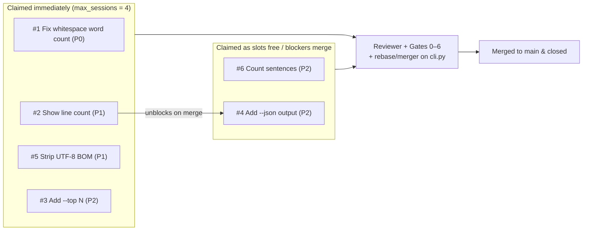

# Sample: hello world (`textstats`)

A 15–30 minute first run of `issuelooper`. The starting app is `textstats`, a small Python CLI that counts words and characters and contains a deliberate bug. Six seed issues ask the loop to fix two bugs and add four features. You watch four parallel workers ship them, then talk to the monitor and file an issue of your own through the aide.

## Before you start

Check the [requirements](../../README.md#requirements): `gh` signed in, Python 3.11+, `agy` signed in, `herdr`, and [uv](https://docs.astral.sh/uv/). By default the sample uses `gemini-4-argon-high`; to use Claude Code or another model, edit `issuelooper/config.toml` before running `create.sh` (or edit `.issuelooper/config.toml` in the created repository before starting the loop).

## 1. Create the repository (2 minutes)

```bash
git clone https://github.com/kazunori279/issuelooper
issuelooper/examples/create.sh hello-world <you>/textstats-demo
```

This creates `./textstats-demo`, pushes a private GitHub repository with `issuelooper` installed, and files six issues at `stage:triage`:

| # | Issue | Priority | Dependency |
|---|---|---|---|
| **#1** | Word count is wrong with several spaces or newlines between words | `P0` | None |
| **#2** | Show the number of lines | `P1` | None |
| **#5** | A UTF-8 byte order mark is counted as a character | `P1` | None |
| **#3** | Add `--top N`: the most frequent words | `P2` | None |
| **#4** | Add `--json` to print the counts as JSON | `P2` | Blocked by **#2** |
| **#6** | Count sentences | `P2` | None |



## 2. Start the loop

```bash
cd textstats-demo
herdr --session textstats-demo
```

Inside the `herdr` pane that opens:

```bash
.claude/hooks/issuelooper start
```

A `herdr` tab named `issuelooper` opens with the monitor (top left), an aide (right), and the terminal status view (bottom left). The web dashboard is served at <http://127.0.0.1:8780/>.

## 3. Watch it work (about 20 minutes)

- **Parallel claiming:** the supervisor starts four workers at once (`[pool] max_sessions = 4`) in priority order (`#1`, `#2`, `#5`, `#3`). Issue `#4` stays waiting until `#2` merges.
- **Failing test first (Gate 3):** each worker writes a failing test in `tests/unit/test_issue_<N>.py`, fixes `cli.py`, runs `make verify`, and opens a PR recording the `Fail-before:` counts.
- **Diff review (Gate 5):** the reviewer (`review_gate.py`) checks each diff against `.issuelooper/review_rules.md` (counts must come from the input text; Python standard library only).
- **Conflict resolution:** because all six issues edit `cli.py`, later PRs conflict with earlier merges. The supervisor auto-rebases simple additive conflicts and spawns a `merger` session for overlapping edits. If a rebase breaks a test, the PR is handed back so a worker can update it.
- **Monitor updates:** after each state change, the supervisor sends a `Pool update:` summary to the monitor pane.

## 4. Take part (about 15 minutes)

- **Ask the monitor** (in the top-left pane): `"What has merged so far, and what is still open?"`
- **File an issue through the aide** (in the right pane): `"File an issue: add --min-length N to --top, so words shorter than N letters are skipped."` The aide files it at `stage:triage` with `<!-- aide -->`; a worker claims it within seconds and ships it in about 15 minutes.
- **Try the CLI yourself:** `git pull && uv run textstats README.md --top 3`.

## 5. Stop and clean up

```bash
.claude/hooks/issuelooper stop --all
```

Running `issuelooper start` again picks up where it left off. When you are done with the demo repository, delete it with `gh repo delete <you>/textstats-demo` and remove the local `./textstats-demo` directory.
