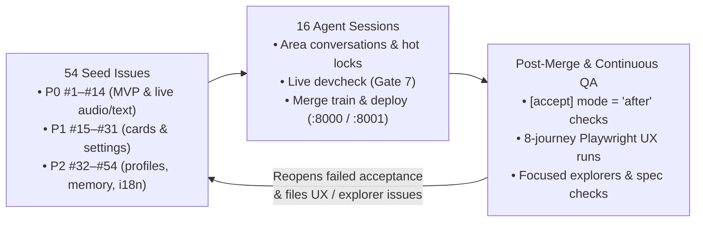

# Sample: Live AI Concierge

The voice-and-text web application `issuelooper` was developed on, built from an initial vertical slice to the full specification in about six hours. Users talk to the concierge by voice or text; it replies out loud, and whenever it calls a tool (weather, web search, places, routes, place details, images, videos) it renders an interactive card beside the conversation. Built with Python, Google ADK, the Gemini Live API, and plain JavaScript.

You start from a working first slice (layout, scripted mode, and the weather card) plus 54 seed issues. The loop builds the rest: live voice and text mode on the real Gemini Live model, the remaining tool cards, settings, conversation history, user profiles, and memory.



## What is in the sample

| Path | Contents |
|---|---|
| `app/` | Starting application. `spec/` holds requirements, acceptance criteria, target screenshots, and a fixture script; `ux/` holds the Playwright UX journeys and grading rubric. |
| `backlog.md` | 54 seed issues with dependencies: `P0` `#1`–`#14` (minimum viable product), `P1` `#15`–`#31`, and `P2` `#32`–`#54`. Eleven issues carry `needs:live`. |
| `issuelooper/` | `config.toml` (`gemini-4-argon-high`, `max_sessions = 16`, `[devcheck]`, `[accept] mode = "after"`, `[ux]`, `[spec]`, `[explore]`, `[areas]`), `project.md`, `review_rules.md`, `monitor_kickoff.md`, and `deploy.sh` (serves `main` on ports `8000` and `8001`). |
| `after_create.sh` | Installs Python dependencies and Playwright Chromium, runs `make verify`, and creates a starter `.env`. |

### The UX checks (`app/ux/`)

During the run, tester sessions walk the deployed app using the material in `app/ux/`:

- **`ux/journeys.py`**: an 8-journey Playwright script (desktop first visit, mobile phone user, heavy multi-card user, settings and memory, Japanese UI and turns, saved location on mobile, multi-profile switching, and server restart recovery) plus `--live` on the real model with voice barge-in. It starts its own app instance, captures a screenshot after every step, and logs status pills, console/page errors, and unusable controls (~4 minutes per run).
- **`ux/ux_script.json`**: fixture data with different locations, numbers, and languages from `spec/fixtures/script.json`, catching code that hard-codes the spec fixtures.
- **`ux/rubric.md`**: defines blocker (`P0`), major (`P1`), and minor (`P2`) friction and what counts as missing scope while seed issues are still open.

Findings are filed directly into the queue as `UX: ...` issues.

## Before you start

- **Base [requirements](../../README.md#requirements):** `gh` signed in, Python 3.11+, `agy` signed in with access to `gemini-4-argon-high`, `herdr`, and [uv](https://docs.astral.sh/uv/) on Linux or macOS.
- **Google Cloud & Vertex AI:** a Google Cloud project with the Vertex AI API enabled and Application Default Credentials configured (`gcloud auth application-default login`). Live mode uses `gemini-3.8-live` in `us-central1` (`LIVE_MODEL` in `.env`).
- **Google Maps JavaScript API key *(optional)*:** restricted to `http://localhost:*/*` (testers and `devcheck` start the app on dynamic ports). Without a key, location and route cards fall back to list views.
- **Free ports `8000` and `8001`:** used by `deploy.sh` to serve `main` in scripted mode (`:8000`) and live mode (`:8001`).
- **Model quota and cost:** running up to 16 concurrent sessions for six hours consumes substantial token quota. In our six-hour run on a single model, sessions hit the per-minute rate limit 52 times; the supervisor automatically pauses the quota group and stops session timeout clocks during each wait, though higher quota finishes faster.

## 1. Create the repository (10 minutes)

```bash
git clone https://github.com/kazunori279/issuelooper
issuelooper/examples/create.sh live-ai-concierge <you>/concierge
```

Edit `concierge/.env` (git-ignored) and set `GOOGLE_CLOUD_PROJECT` (plus `GOOGLE_MAPS_API_KEY` if you have one). Workers and testers symlink `.env` from the shared checkout into their worktrees; without it, `needs:live` issues cannot pass live verification.

## 2. Start the loop

```bash
cd concierge
herdr --session concierge
# Inside the herdr pane:
.claude/hooks/issuelooper start
```

The monitor, an aide, and the status view open in the `issuelooper` tab, and the web dashboard starts at <http://127.0.0.1:8780/>.

## 3. What happens during the run

Times and UX scores vary with the model and settings. In a test run of the sample (run 14, six hours on `gemini-3.8-flash-high` with `"gate"` acceptance and an owner who only answered `stage:owner` questions), most seed issues closed, with closes trailing merges by about an hour while waiting for post-merge acceptance.

The current sample configuration uses `[accept] mode = "after"` (see [Post-merge acceptance](../../docs/how-it-works.md#4-post-merge-acceptance-accept-mode)):
- **Immediate close on merge:** each PR uses `Fixes #N`, so merging closes the issue and unblocks dependent issues right away.
- **Independent post-merge verification:** once deployed, independent tester units verify every seed issue, `owner-request`, `P0`, `P1`, and `needs:live` issue plus 1 in 4 of the rest against the shared acceptance checklist (`1280x800`, `390x844`, `320x640`, English and Japanese, keyboard navigation, reload persistence, and live voice/text turns). Confirmed failures reopen at `stage:triage` (`P1`, `accept:failed`) and resume the author's conversation.
- **First hour:** up to 16 workers build the `P0` issues. Live mode lands in stages (`#1` text through ADK first, which unblocks voice output, microphone capture, voice input, and live tool cards).
- **Continuous UX, explorer, and spec runs:** periodic UX runs grade what is built so far, and free slots run focused explorers and spec checks that file the next work.

Every merge deploys automatically: try scripted mode at <http://localhost:8000/> and live mode at <http://localhost:8001/>.

## 4. Your role during the run

The loop runs unattended, and your input steers it further:

- **Answer `stage:owner` questions:** check `gh issue list --label stage:owner` or the dashboard's **Needs you** banner and reply on the issue.
- **Try the deployed app on `:8000` and `:8001`:** file anything you want changed (or ask the aide pane to file it) with the `owner-request` label so it stays at `P1` or above.
- **Reprioritize in the monitor pane:** ask the monitor what shipped, what is blocked, or which issues to move to `P0`.

## 5. Stop

```bash
.claude/hooks/issuelooper stop --all
```

This stops the supervisor, running agent sessions, dashboard, and panes. To stop the deployed background servers on `:8000` and `:8001` as well, run:

```bash
lsof -tiTCP:8000 -tiTCP:8001 -sTCP:LISTEN | xargs kill
```
